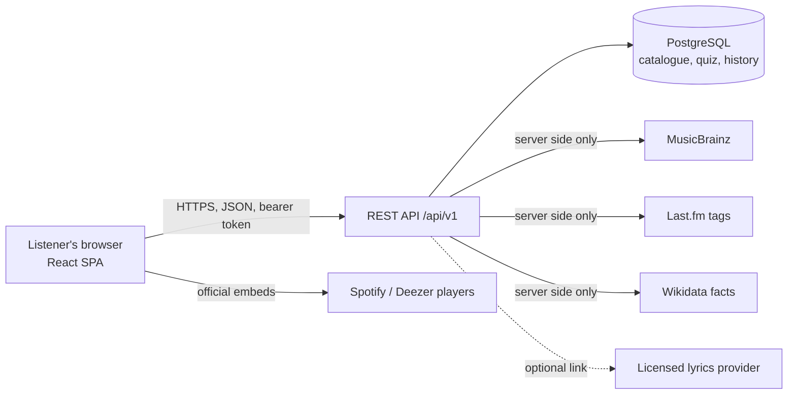
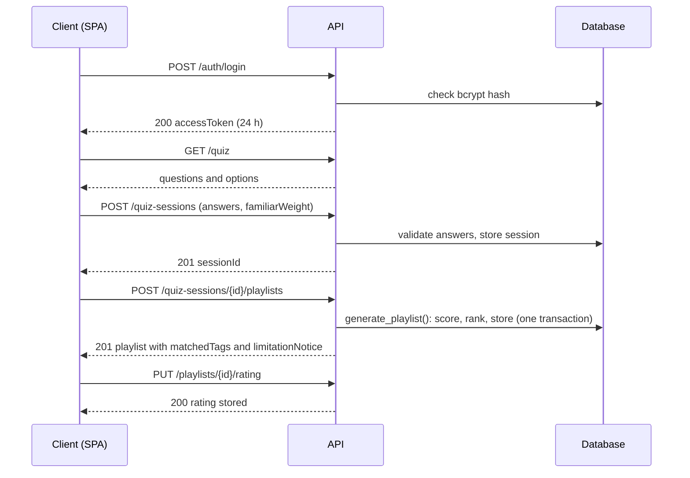

# Architecture overview

## System context

The browser talks only to the API. External metadata is fetched by the backend and cached in the database; audio is played by official embedded players, never served by this API.

## Request flow: quiz to playlist

## Ranking lifecycle

1. The answers are mapped to weighted mood tags (database tables `quiz_option_tag`).
2. Tracks are scored by tag overlap: `sum(mood weight x track tag weight)`.
3. The balance multiplier is applied: `0.5 + familiarWeight` for heard tracks, `1.5 - familiarWeight` for new ones.
4. Tracks are sorted by score, ties by the lower track id; at most `limit` are returned.
5. The matched tags of each track are returned as the explanation. Fewer matches than `limit` produce all matches plus a `limitationNotice`.

## Resources

| Resource | Endpoints | Database tables |
|---|---|---|
| Auth, profile | `/auth/*`, `/users/me`, `/users/me/history` | `app_user` |
| Quiz | `/quiz`, `/quiz-sessions` | `quiz_question`, `quiz_option`, `quiz_option_tag`, `quiz_session`, `quiz_answer` |
| Playlists | `/quiz-sessions/{id}/playlists`, `/playlists`, `/playlists/{id}`, `/playlists/{id}/rating` | `playlist`, `playlist_item` |
| Catalogue | `/tracks/{id}`, `/artists/{id}` | `track`, `artist`, `track_tag`, `track_fact`, `lyric_access`, `artist_genre`, `genre_relation` |
| Activity | `/listening-events`, `/feed` | `listening_event`, `track_fact` |
