# Architecture and approach

## Layers

| Layer          | Responsibility                                                                                                                      | Files                           |
| -------------- | ----------------------------------------------------------------------------------------------------------------------------------- | ------------------------------- |
| Routing        | URL to page, redirect visitors to `/login`, 404 page                                                                                | `App.tsx`, `ProtectedRoute.tsx` |
| Pages          | Compose components, own page-level UI state (quiz step, feed filter)                                                                | `pages/*`                       |
| Server state   | Fetch, cache, retry, paginate (`useInfiniteQuery`), invalidate after writes                                                         | `api/queries.ts`                |
| Client state   | Session, theme, toasts                                                                                                              | `stores/*`                      |
| API client     | One `request()`; adds the bearer token, parses `application/problem+json` into `ApiError`, turns a failed fetch into `NetworkError` | `api/client.ts`                 |
| Error handling | One handler for every failed query/mutation                                                                                         | `api/globalErrorHandler.ts`     |
| Presentation   | Tokens in `themes.css`; components use only `var(--token)`                                                                          | `styles/*`                      |

## Approach

- **Contract first.** Types in `api/types.ts` follow `openapi.yaml`; the mock server implements the same 18 operations, so switching to the real backend is a config change (`VITE_API_MOCK=false`).
- **Server state is not copied into a store.** TanStack Query owns it; Zustand holds only what the server does not: token and user, theme, toasts.
- **Errors are shown where the user can act.** 404 and 422 appear in the page or the field. 401 clears the session and returns to login. 403, 429, 5xx and network errors become a toast; transient failures are retried once.
- **Forms** validate on the client with zod (same rules as the API) and show server `errors[]` on the matching field.
- **Security.** The token lives in `sessionStorage` (gone when the tab closes), is sent only by the API client, and is never logged. No secrets in the bundle. External links use `rel="noreferrer noopener"`. React escapes all rendered text.
- **Accessibility.** Native controls (radio, range, checkbox), visible labels, `aria-invalid`/`aria-describedby` on errors, `role="alert"` and `aria-live` for messages, a skip link, a focus ring from the theme, 44 px touch targets, `prefers-reduced-motion`.
- **Responsive.** Mobile first; the shell switches at 768 px (top navigation) and 1100 px (sidebar).
- **Performance.** Route-independent vendor chunks (`react`, `data`, `forms`), query cache with `staleTime`, skeletons instead of spinners, fonts with `display=swap`.

## Error handling table

| Situation                    | What the user sees                                   |
| ---------------------------- | ---------------------------------------------------- |
| Wrong password (401)         | Message in the form                                  |
| Too many logins (429)        | Message with the wait time                           |
| Session expired (401)        | Toast, redirect to login                             |
| Listening history off (403)  | Toast with how to turn it on                         |
| Not found (404)              | Friendly page state                                  |
| Server error (5xx) / offline | Toast with retry advice; page state with "Try again" |
