# User flows

1. **First visit.** Visitor opens any page, is sent to _Sign in_, can switch to _Create account_.
2. **Quiz.** Four single-choice questions, then the _familiar or new_ slider. _Next_ is disabled until an option is chosen; _Back_ keeps answers.
3. **Playlist.** Ranked tracks with matched mood tags and a _Familiar_ marker. If fewer tracks match than requested, a notice explains it. The user rates mood fit 1 to 5.
4. **Track.** Facts with sources, genres, related genres, player placeholder. _I listened to this_ saves a play (only with history consent).
5. **Feed.** Facts about music the user played; search, filter by type, sort by date.
6. **Profile.** Toggle listening history, delete history, delete account.
